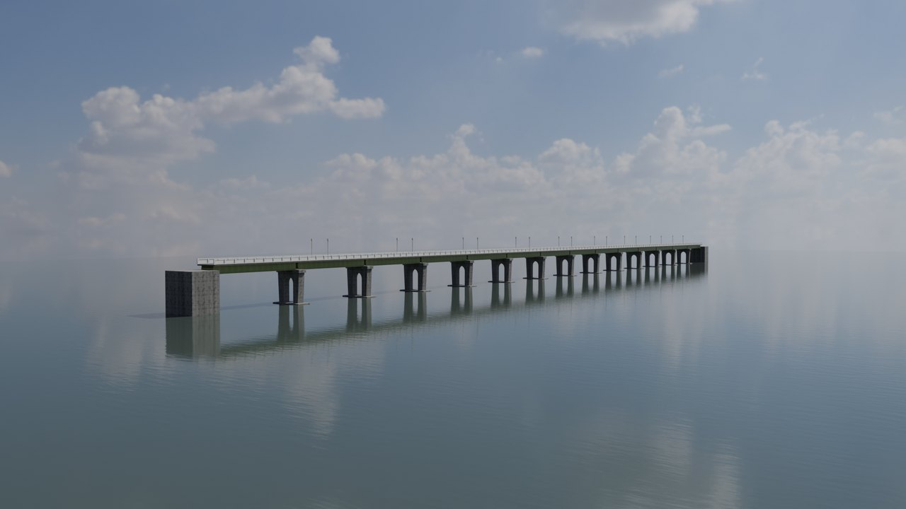
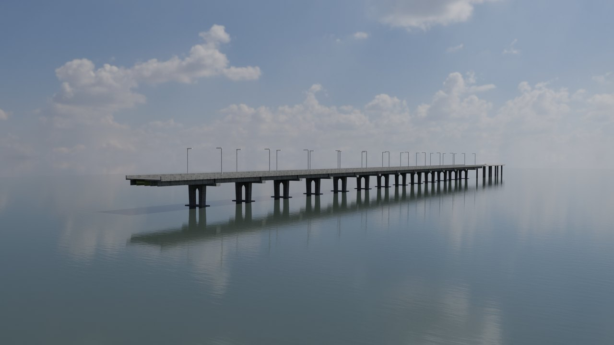
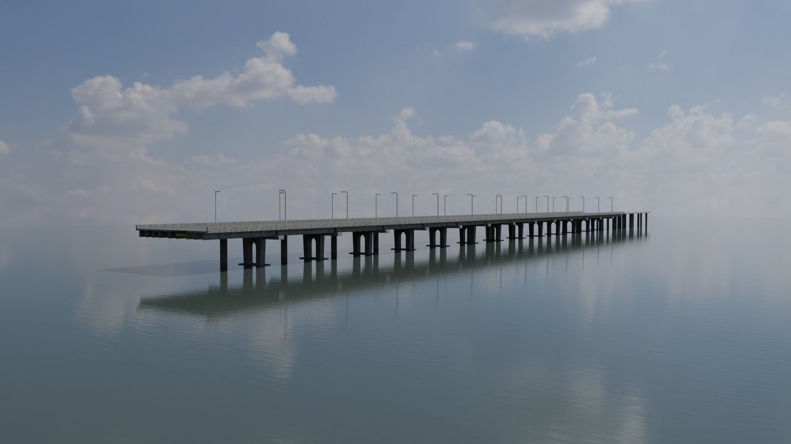
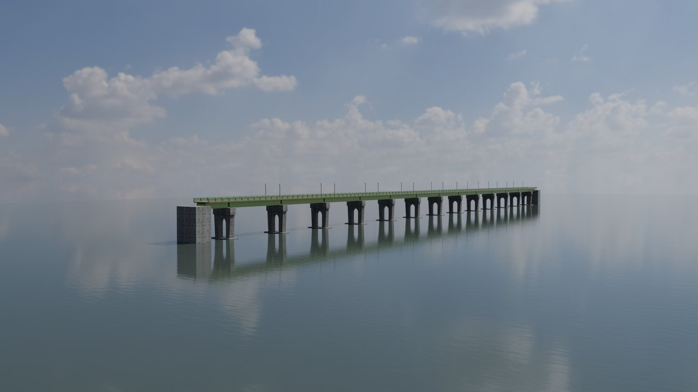

# 川端橋 3D 模型 Kawabata Bridge 3D

台北川端橋（戰後改稱中正橋）四個時期的程序化 Blender 模型：1937 年通車時的原橋、1961 年拓寬到 15.4 公尺並往永和端延長、1972 年再拓寬到 24.5 公尺（一直用到 2019 年新橋動工），以及 2026 年 9 月修復後只剩 1937 年橋墩與鋼梁的人行橋。模型原本是為短片〈[川端橋重新開放：中正橋從 24.5 公尺瘦回 6 公尺，留下 1937 年的橋墩和鋼梁](https://youtu.be/5KYwAcQU7-E)〉做的，這裡把橋體單獨整理出來，給想研究、改作或拿去做其他作品的人用。姊妹作：[明治橋 3D 模型](https://github.com/pirrer/meiji-bridge-3d)。

| 1937 | 1961 |
|---|---|
|  |  |
| **1972** | **2026** |
|  |  |

> ⚠️ **這是示意模型，不是設計圖。** 有文獻數字的只有 1937 年全長 300.56 m、寬 5.2 m、14 孔 13 墩，戰後的 15.4 m、24.5 m，以及 2026 年全寬 6 m。墩高、梁深、加寬斷面、永和端延長段的柱位、2026 帽梁抬升量都是照片判讀或示意，誤差可能到數公尺。依據逐項列在 [REFERENCES.md](REFERENCES.md)，發現錯誤歡迎開 issue 附上資料。

## 直接下載

[Releases](../../releases) 有現成檔案：

- `kawabata_<年代>.glb`：通用格式，網頁（three.js、model-viewer）、Unity、Unreal 都能開。材質是簡化版（每種材質一個平均色）。
- `kawabata_<年代>.blend`：Blender 4.5，完整 PBR 材質，貼圖已打包在檔案裡。

## 自己建

需要 [Blender 4.5](https://www.blender.org/download/) 和 Python 3。

```bash
python fetch_textures.py        # 從 Poly Haven 下載貼圖（CC0，約 45 MB）到 assets/
blender -b -P build.py -- --era 1937 --blend out/kawabata_1937.blend --glb out/kawabata_1937.glb
blender -b -P build.py -- --era 2026 --render out/kawabata_2026.png --samples 64   # 渲一張預覽圖
```

- `--era`：`1937`／`1961`／`1972`／`2026`
- `--blend`：存 .blend（貼圖用相對路徑指向 `assets/`；加 `--pack` 打包進檔案）
- `--glb`：匯出 .glb
- `--render`：用 Cycles 渲一張下游側斜看全橋的預覽（附一片水面當參考）；`--res 1920x1080`、`--samples 128`

座標：x 沿橋軸，0＝1937 年台北端（北岸）橋台、往永和為正；y 橫橋，正值＝上游；z 向上，0＝常水位；單位公尺。.glb 依 glTF 慣例轉成 Y 軸朝上。

## 各年代有什麼

| 年代 | 構件 |
|---|---|
| 1937 | 13 座雙柱式拱型墩、14 孔上承式鉚釘鋼鈑梁、5.2 m 橋面、直立欄杆與柱燈、兩端橋台 |
| 1961 | 1937 墩與鋼梁＋兩側 PC 梁加寬到 15.4 m、新護欄與路燈、永和端延長段 |
| 1972 | 再往上游側加寬到 24.5 m，多一排單柱帽梁墩；延長段同步加寬 |
| 2026 | 戰後增建全部拆除，只留 1937 的墩與鋼梁；帽梁增築抬升、鋼梁漆回綠色、6 m 木質步道與新欄杆 |

## 檔案

| 檔案 | 內容 |
|---|---|
| `build.py` | 入口：材質、建橋、存檔、匯出、預覽 |
| `src/kawabata.py` | 橋體：拱型墩、鋼鈑梁、各期加寬、永和端延長、2026 修復後橋面 |
| `src/lib.py` | 共用：Poly Haven PBR 材質（物件座標 box 投影）、天光、相機、幾何小工具（與明治橋 repo 相同） |
| `fetch_textures.py` | 下載所需的 Poly Haven 貼圖與 HDRI |

原始影片還有周邊地形、河道、堤防、城市、新中正橋、渡船，以及拆除增建與抬升的動畫；這些用到授權條件不同的地理資料與航照判讀結果，沒有放進這個 repo。

## 授權

- 程式碼：MIT（[LICENSE](LICENSE)）
- 模型與圖片：CC BY 4.0（[LICENSE-MODELS.md](LICENSE-MODELS.md)），使用時請標示「川端橋 3D 模型，fOx Hsiao，CC BY 4.0」並附本頁連結
- 貼圖：Poly Haven，CC0

---

## English

Procedural Blender models of Taipei's Kawabata Bridge (renamed Zhongzheng Bridge after World War II) in four periods: the bridge as opened in 1937; widened to 15.4 m in 1961 with an extension on the Yonghe side; widened again to 24.5 m in 1972, the form it kept until the new Zhongzheng Bridge was built beside it from 2019; and the pedestrian bridge reopened in September 2026 after restoration stripped it back to its 1937 piers and girders. Built for a [short documentary video](https://youtu.be/5KYwAcQU7-E) and released here on their own. Companion project: [Meiji Bridge 3D](https://github.com/pirrer/meiji-bridge-3d).

**These are interpretive models, not engineering drawings.** Only the 1937 length (300.56 m), width (5.2 m) and 14 spans on 13 piers, the post-war widths (15.4 m and 24.5 m), and the 2026 overall width (6 m) come from written sources. Pier height, girder depth, widening cross-sections, the Yonghe-side extension columns, and the 2026 raise are estimated from photos or illustrative. Sources are in [REFERENCES.md](REFERENCES.md). Corrections with evidence are welcome as issues.

**Download** ready-made `.glb` (simplified flat-color materials) and `.blend` (full PBR, textures packed) files from [Releases](../../releases).

**Build** with Blender 4.5:

```bash
python fetch_textures.py
blender -b -P build.py -- --era 1937 --blend out/kawabata_1937.blend --glb out/kawabata_1937.glb
```

`--era` is `1937`, `1961`, `1972`, or `2026`. Axes: x runs along the bridge from the 1937 Taipei (north) abutment toward Yonghe, positive y is upstream, z is up with 0 at normal water level, units in meters. Code comments are in Traditional Chinese.

**License:** code MIT; models and images CC BY 4.0 (credit: "Kawabata Bridge 3D model by fOx Hsiao, CC BY 4.0" with a link to this repo); Poly Haven textures CC0.
